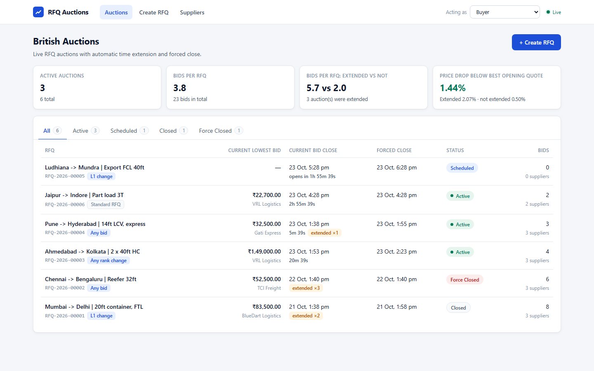

# British Auction in an RFQ System

An RFQ (Request for Quotation) platform for freight with **British-auction** bidding: suppliers openly lower their
prices, the auction **extends automatically** when activity happens near the end, and it **never runs past the forced
close time**. Ranks, prices and the reason for every extension are visible live.

**Stack:** Python 3.11+ · FastAPI · SQLAlchemy 2 · PostgreSQL · Alembic · React 18 + TypeScript (Vite) · WebSockets · pytest

| Deliverable | Where |
|---|---|
| HLD with architecture diagram | [`docs/HLD.md`](docs/HLD.md): architecture, bid sequence diagram, lifecycle state machine, design decisions, scaling path |
| Schema design | [`docs/SCHEMA.md`](docs/SCHEMA.md) (ER diagram + constraints) and [`docs/schema.sql`](docs/schema.sql) (exact PostgreSQL DDL) |
| Backend code | [`backend/`](backend) |
| Frontend code | [`frontend/`](frontend) |



---

## Requirements coverage

| Assignment requirement | Implementation |
|---|---|
| **§5 RFQ creation** with British Auction option: name/reference ID, bid start, bid close, forced close, pickup/service date | `POST /api/rfqs` · *Create RFQ* page. Reference ID auto-generated (`RFQ-2026-00001`) if left blank. The British Auction toggle can be turned off for a standard RFQ. |
| **Quote fields:** carrier name, freight / origin / destination charges, transit time, quote validity | `POST /api/rfqs/{id}/bids` · bid form on the details page. Total = sum of charges. |
| **§5 Rule:** auction must never extend beyond the forced close | Enforced 3×: engine caps `min(close + Y, forced)`, bids are rejected at/after close, and DB `CHECK (current_close_at <= forced_close_at)`. |
| **§6.1 Trigger window X** | `trigger_window_minutes`. A bid counts if `current_close − X ≤ t < current_close`. The window slides forward with each extension. |
| **§6.2 Extension duration Y** | `extension_minutes`, added to the **current close time** (6:00 → 6:05, as in the brief). |
| **§6.3a** Bid received in last X min | `BID_RECEIVED` |
| **§6.3b** Any supplier rank change in last X min | `ANY_RANK_CHANGE`: fires when any already-ranked supplier changes position |
| **§6.3c** L1 change in last X min | `L1_CHANGE`: fires only when a different supplier becomes the lowest bidder |
| **§7 Validation** forced close > bid close; extensions ≤ forced close | Pydantic validators (clear messages) + client-side checks + DB `CHECK` constraints |
| **§8 Listing page:** RFQ name/ID, current lowest bid, current bid close, forced close, status (Active / Closed / Force Closed) | `/` (plus *Scheduled* for future auctions, live countdowns, extension count, status filter tabs) |
| **§8 Details page:** bids sorted by price, L1/L2/L3 ranking, quote details, X & Y config, activity log with bids, extensions and the reason for each | `/rfqs/:id` (plus visual timeline, full bid-revision history and a live "will this bid extend the auction?" hint) |
| **§4 Success metrics:** bids per RFQ; final prices for extended vs non-extended auctions | `GET /api/metrics`, shown as cards on the listing page |


## Beyond the brief

* **Real-time:** WebSocket push (`/ws`) updates rankings, close times and status on every open screen, with polling as a fallback.
* **Concurrency-safe bidding:** `SELECT … FOR UPDATE` on the RFQ row serialises bids per auction, so two last-second bids can't double-extend (see [HLD §3](docs/HLD.md#3-bid-submission-flow-the-critical-path)).
* **Server-authoritative time:** bids are timestamped by the server, and the UI corrects its countdown for client clock skew.
* **Pure, tested rules engine:** 42 tests, including every trigger type, window boundaries, capping, and replays of the brief's own 5:55 / 5:58 / 5:59 PM examples.
* **Audit trail:** bids are append-only revisions, and every extension logs `old → new` close time and a human-readable reason.
* **Seeded demo data generated by the real engine** plus a bidding bot to watch extensions happen live.

---

## Running it

### Option A: Docker (one command)

```bash
docker compose up --build
# then, in another terminal, load demo data:
docker compose exec backend python -m scripts.seed
```
Open **http://localhost:8080** (API docs at http://localhost:8000/docs).

### Option B: Local (PostgreSQL + Python + Node)

Prerequisites: Python 3.11+, Node 18+, PostgreSQL 14+.

```bash
# 1. Database
createdb british_auction            # or: psql -U postgres -c "CREATE DATABASE british_auction"

# 2. Backend
cd backend
python -m venv .venv
.venv\Scripts\activate              # Windows   (macOS/Linux: source .venv/bin/activate)
pip install -r requirements-dev.txt
copy .env.example .env              # macOS/Linux: cp .env.example .env, then set DATABASE_URL
alembic upgrade head
python -m scripts.seed              # optional demo data (use --reset to wipe first)
uvicorn app.main:app --reload       # http://localhost:8000  ·  Swagger: /docs

# 3. Frontend (new terminal)
cd frontend
npm install
npm run dev                         # http://localhost:5173 (proxies /api and /ws to :8000)
```

> No PostgreSQL handy? The backend also runs on SQLite for a quick look:
> `DATABASE_URL=sqlite:///./demo.db` in `.env`. PostgreSQL is the intended target, since row locking only matters there.

### Try it

1. Open the **Pune → Hyderabad** auction from the seed data. It is created inside its trigger window.
2. In the header, switch **Acting as** to a supplier, then submit a quote below L1. The close time jumps by Y minutes,
   the timeline grows a purple "extension" segment, and the activity log shows the reason.
3. Or let the bot bid for you: `python -m scripts.simulate_bidding --rfq 4 --every 8`
4. Watch the **Chennai → Bengaluru** auction for an example that ran into its forced close (status *Force Closed*,
   with an *Extension blocked* entry in the log).

### Tests

```bash
cd backend
pytest                    # 42 tests: engine unit tests + API tests on a frozen clock
cd ../frontend
npm run build             # strict TypeScript type-check + production build
```

---

## API

| Method | Path | Description |
|---|---|---|
| `GET` | `/api/rfqs?status=ACTIVE` | Listing (lowest bid, L1 supplier, current/forced close, status, counts) |
| `POST` | `/api/rfqs` | Create an RFQ / British auction |
| `GET` | `/api/rfqs/{id}` | Details: config, ranking with L-labels and full quote details, `server_time` |
| `GET` | `/api/rfqs/{id}/bids` | Every bid revision, newest first |
| `POST` | `/api/rfqs/{id}/bids` | Submit a quote → `{rank_label, extended, new_close_at, extension_reason}` |
| `GET` | `/api/rfqs/{id}/activity` | Activity log |
| `GET/POST` | `/api/suppliers` | Suppliers |
| `GET` | `/api/metrics` | Success metrics |
| `WS` | `/ws` | Push: `{"type":"rfq_updated","rfq_id":N,"reason":"bid"\|"extended"\|"status_changed"\|"created"}` |

Interactive docs: **http://localhost:8000/docs**

## Rules and assumptions

These are the points where the brief leaves room for interpretation, and how this build resolves them:

* **Extension is added to the current close time**, not to the bid time (the brief's 6:00 → 6:05 example).
  The trigger window is measured from the *current* close, so it moves with each extension.
* **Window boundaries:** a bid exactly X minutes before close is inside; a bid at the close instant is rejected.
* **Capping:** if `close + Y` would pass the forced close, the close becomes the forced close (logged as *capped*).
  Once at the forced close, further triggers are logged as *Extension blocked*.
* **Force Closed** = the auction ended at its forced close time (extensions reached the ceiling).
  **Closed** = it ended at a (possibly extended) close time before the ceiling.
* **Re-bidding:** a supplier may only *lower* their own total. Each re-bid is a new revision, and their best one counts.
* **Ranking ties:** equal totals rank by who reached that price first.
* **"Any rank change"** means an already-ranked supplier changed position. A new supplier entering in last place
  moves no one, so it doesn't count. Entering above someone does. **"L1 change"** includes the first-ever bid.
* **Status** is derived from the server clock on every request, and a background job persists transitions and logs closures.
* **Identity:** no auth in this scope. The header's *Acting as* switch (Buyer / supplier) stands in for login.

## Project structure

```
backend/
  app/
    main.py               FastAPI app, error handlers, background closer lifecycle
    api/routes.py         REST + WebSocket endpoints
    models.py             SQLAlchemy models + DB constraints
    schemas.py            Pydantic request/response models + validation rules
    services/
      auction_engine.py   pure rules: ranking, trigger window, extension, cap, status
      bidding.py          transactional bid submission (row lock)
      rfq_service.py      create / list / details / activity / metrics
      closer.py           background job: start/close transitions
    realtime.py           WebSocket fan-out
  alembic/                migrations
  scripts/seed.py         demo data replayed through the real engine
  scripts/simulate_bidding.py
  tests/                  engine + API tests
frontend/
  src/pages/              AuctionList, AuctionDetail, CreateRfq, Suppliers
  src/components/         BidForm, AuctionTimeline, Layout, shared UI
  src/lib/                typed API client, live-update + server-clock hooks, formatting
docs/                     HLD, schema, screenshots
```
