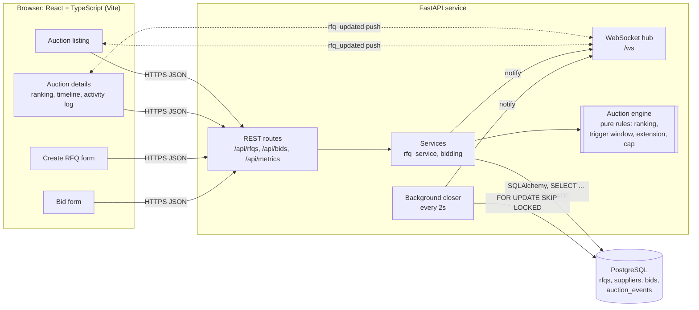
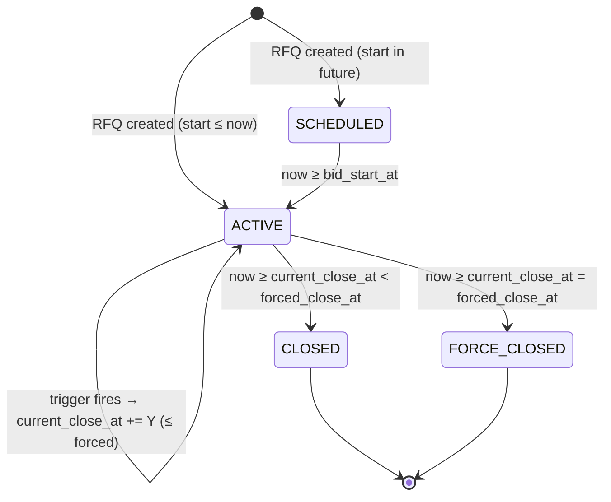

# High-Level Design: British Auction in an RFQ System

## 1. Goals

Buyers publish an RFQ (Request for Quotation) for a freight lane. Suppliers compete openly by lowering their quotes.
The auction **extends automatically** when there is activity close to the end, but can **never run past the forced
close time**. Everyone sees ranks, prices and the reason for every extension in real time.

## 2. Architecture



| Component | Responsibility |
|---|---|
| **React SPA** | Listing, details, RFQ creation and bid submission. Countdowns use a **server-synchronised clock** (offset learned from `server_time` in each response), so a wrong laptop clock can't mislead a supplier. |
| **REST API (FastAPI)** | Validation (Pydantic), routing, error mapping. Stateless. |
| **Auction engine** (`app/services/auction_engine.py`) | Pure functions with no I/O: `rank()`, `in_trigger_window()`, `rank_changed()`, `l1_changed()`, `evaluate_extension()`, `compute_status()`. All British-auction rules live here and are unit-tested in isolation. |
| **Bidding service** | The only write path that can move the close time. It runs one DB transaction per bid. |
| **Background closer** | Moves auctions `SCHEDULED → ACTIVE → CLOSED / FORCE_CLOSED`, writes the closing entry to the activity log, and pushes a notification. |
| **WebSocket hub** | Pushes thin `{"type":"rfq_updated","rfq_id":N}` messages; clients re-fetch over REST, so REST stays the single source of truth. Clients also poll every 10–15 s as a safety net. |
| **PostgreSQL** | System of record. Business invariants are enforced again with `CHECK` constraints. |

## 3. Bid submission flow (the critical path)

```mermaid
sequenceDiagram
    autonumber
    participant S as Supplier (UI)
    participant API as FastAPI
    participant DB as PostgreSQL
    participant E as Auction engine
    participant H as WS hub

    S->>API: POST /api/rfqs/{id}/bids
    API->>DB: BEGIN; SELECT * FROM rfqs WHERE id=? FOR UPDATE
    Note over API,DB: Row lock serialises all bids on this auction
    API->>API: now = server clock (taken after the lock)
    API->>API: reject if now < start or now >= current_close_at
    API->>DB: load bids → standings (best quote per supplier)
    API->>API: reject if total >= supplier's current quote
    API->>DB: INSERT bid
    API->>E: ranking_before, ranking_after, trigger, X, Y, current close, forced close
    E-->>API: ExtensionDecision(extended, new_close_at, capped, reason)
    API->>DB: INSERT auction_events (BID_SUBMITTED [+ AUCTION_EXTENDED / EXTENSION_CAPPED])
    API->>DB: UPDATE rfqs SET current_close_at, extension_count
    API->>DB: COMMIT
    API->>H: rfq_updated(id)
    H-->>S: push → every open screen re-fetches
    API-->>S: 201 {rank, extended, new_close_at, reason}
```

### Why a row lock?
Two suppliers bidding at 5:59:59 must not both read "close = 6:00" and each extend from it. `SELECT … FOR UPDATE` on the
RFQ row makes bids on **the same auction** strictly sequential, so ranking-before/after is exact and extensions
are applied exactly once each. Bids on **different** auctions never contend. The bid's official timestamp is
taken *after* acquiring the lock, so a bid that waited on the lock past the close time is correctly rejected.

## 4. Extension rules

Let `close` = the **current** close time (it moves with each extension), `X` = trigger window, `Y` = extension.

1. A bid is **inside the trigger window** if `close − X ≤ bid_time < close`.
2. Whether the trigger fires depends on the configured type:

| Trigger | Fires when |
|---|---|
| `BID_RECEIVED` | any accepted bid inside the window |
| `ANY_RANK_CHANGE` | any *already-ranked* supplier's position changes (a newcomer entering last moves nobody, so it doesn't count) |
| `L1_CHANGE` | the lowest bidder is now a different supplier (including the very first bid) |

3. If it fires: `new_close = min(close + Y, forced_close)`.
   * Extended exactly → `AUCTION_EXTENDED` with the reason.
   * Shortened by the cap → `AUCTION_EXTENDED` (capped = true).
   * Already at forced close → `EXTENSION_CAPPED` (the trigger fired but there's no room left). This is logged so the
     buyer can see why the auction didn't extend.
4. The extension is added to the **current close time**, not the bid time (assignment example: 6:00 → 6:05).
   Because the window is measured from the current close, it slides forward with every extension.

The guarantee that the auction never passes the forced close is enforced three times: by the engine (`min(...)`),
by the bid check (`now < current_close_at ≤ forced_close_at`), and by the database constraint
`CHECK (current_close_at <= forced_close_at)`.

## 5. Auction lifecycle



* **Status is derived from time** (`compute_status`) on every read, so the UI is correct to the second even if the
  closer is late. The closer only *persists* the transition, logs the closing event (timestamped at the actual close
  time, not when the job ran), and notifies clients.
* **Force Closed** means the bidding ran into the hard ceiling: extensions pushed the close time all the way to the
  forced close.

## 6. Key design decisions

| Decision | Why |
|---|---|
| Bids are **append-only**; a re-bid is a new row with `revision + 1` | A full audit trail. "Current quote" = the supplier's best (latest) row. |
| A supplier may only **lower** their own price | That is what a British (reverse) auction is: continuous price improvement. |
| Ties: same total → **whoever reached it first ranks higher** | Copying the leader's price doesn't steal L1. |
| `bid_close_at` (original) and `current_close_at` (moving) stored separately | The UI can show "originally 6:00, now 6:10", and metrics can compare extended vs non-extended auctions. |
| Pure engine module | Every rule is unit-tested without a DB (`tests/test_auction_engine.py`). |
| Server clock is authoritative; API returns `server_time` | No client can bid "in time" using a skewed clock, and countdowns stay accurate. |
| Money as `NUMERIC(14,2)` / `Decimal`, sent as strings | No float rounding in prices or rankings. |
| Thin WS messages + REST re-fetch | One source of truth and no state drift. A missed message is fixed by the next poll. |
| British Auction is optional per RFQ | Matches "create an RFQ with the British Auction option enabled", and gives a control group for the "extended vs non-extended" success metric. |

## 7. Success metrics (assignment §4)

`GET /api/metrics` (shown on the listing page) reports:
* **Bids per RFQ**: overall, and for extended vs non-extended auctions.
* **Price improvement**: how far the final L1 dropped below the best *opening* quote, for extended vs non-extended
  auctions.

## 8. Scaling path

The current build is one API process, which is right for this scope. Going further:

| Concern | Next step |
|---|---|
| Multiple API replicas | Bid path already safe (row lock). Closer already safe (`SKIP LOCKED`). Move WS fan-out to **Redis pub/sub** (or PG `LISTEN/NOTIFY`) so every replica relays notifications to its own sockets. |
| Background work | Replace the in-process closer with a **Celery beat** task, or schedule a Celery ETA task per auction at `current_close_at` (re-scheduled on each extension), with **RabbitMQ/Redis** as broker. Notification emails/webhooks to suppliers ("you've been outbid") also become Celery jobs. |
| Read load on hot auctions | Cache the ranking per RFQ in Redis, invalidated on each bid commit. |
| Auth | JWT with buyer/supplier roles; suppliers see only their own quote details if sealed-price mode is required. |
| Supplier-network analytics | A graph store (e.g. Neo4j) for supplier ↔ lane ↔ buyer relationships, to recommend whom to invite to an RFQ. |
