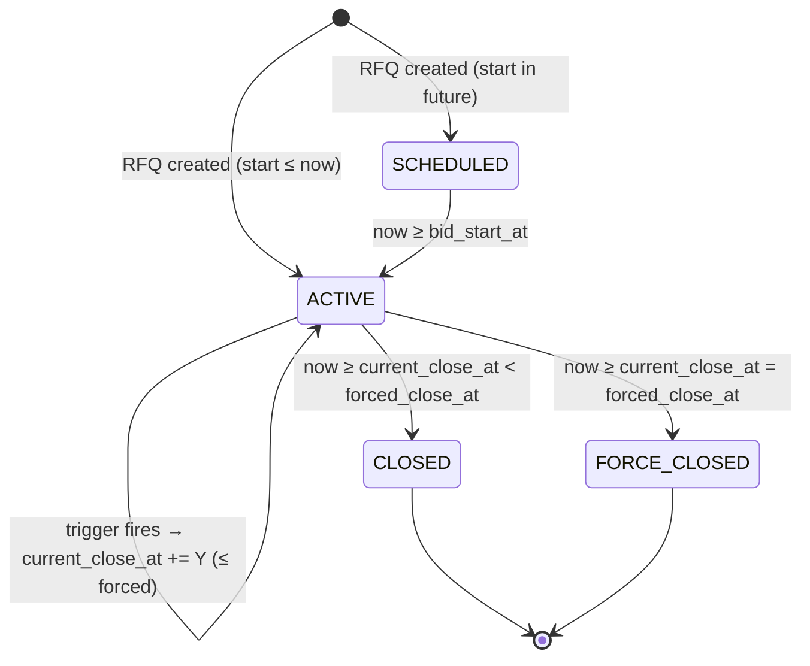
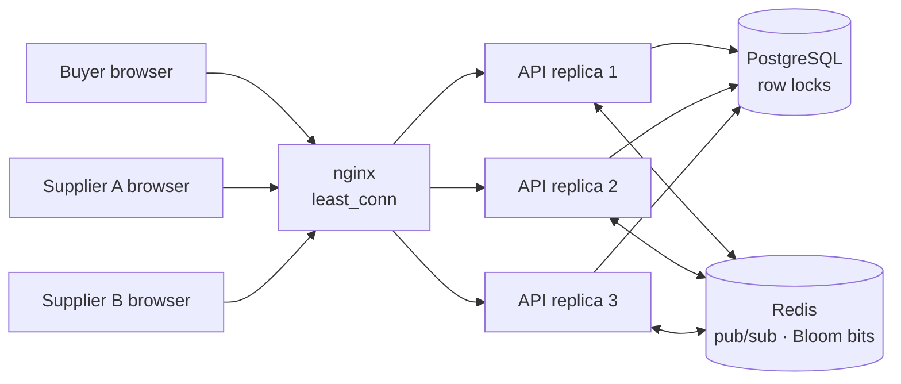
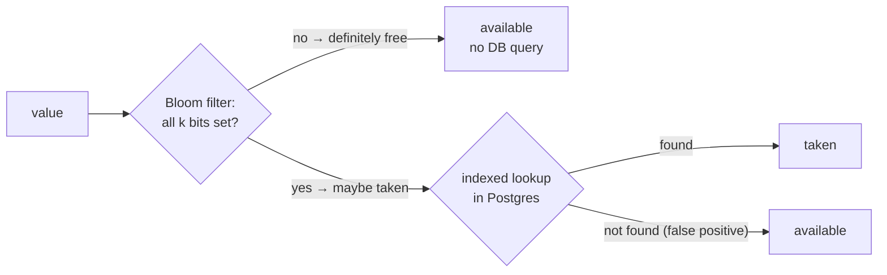

# High-Level Design: British Auction in an RFQ System

## 1. Goals

Buyers publish an RFQ (Request for Quotation) for a freight lane. Suppliers compete openly by lowering their quotes.
The auction **extends automatically** when there is activity close to the end, but can **never run past the forced
close time**. Everyone sees ranks, prices and the reason for every extension in real time.

## 2. Architecture

```mermaid
flowchart LR
    subgraph Client["Browser: React + TypeScript"]
        UI[Buyer & supplier dashboards · Listing · Details<br/>Create RFQ · Bid form · server-synced clock]
    end

    LB[nginx load balancer<br/>least_conn · WebSocket upgrade<br/>serves the static UI]

    subgraph API["FastAPI (1..N replicas)"]
        AUTH[Auth<br/>JWT, buyer/supplier roles]
        R[REST routes]
        WS[WebSocket hub /ws]
        SVC[Services<br/>rfq_service, bidding]
        ENG[[Auction engine<br/>pure rules]]
    end

    subgraph BG["Background jobs"]
        BEAT[Celery beat<br/>every 2s]
        WRK[Celery worker<br/>auction.close_due]
    end

    PG[(PostgreSQL)]
    RD[(Redis<br/>broker + pub/sub)]

    UI -- "HTTPS JSON + Bearer token" --> LB --> AUTH --> R --> SVC --> ENG
    UI <-. "WebSocket" .-> LB
    SVC -- "SELECT … FOR UPDATE" --> PG
    LB <-. "rfq_updated" .- WS
    SVC -- "PUBLISH rfq_updates" --> RD
    BEAT -- enqueue --> RD --> WRK
    WRK -- "FOR UPDATE SKIP LOCKED" --> PG
    WRK -- "PUBLISH rfq_updates" --> RD
    RD -- "SUBSCRIBE (every replica)" --> WS
```

| Component | Responsibility |
|---|---|
| **nginx load balancer** | Spreads `/api` and `/ws` over the API replicas (`least_conn`), re-resolves Docker DNS so scaled or restarted replicas join automatically, upgrades WebSockets, retries idempotent requests on another replica, and serves the built UI. |
| **React SPA** | Listing, details, RFQ creation, bidding. Countdowns use a **server-synchronised clock** (offset learned from `server_time`), so a wrong laptop clock can't mislead a supplier. Before a supplier submits, it shows whether the bid will extend the auction. |
| **Auth** | Email + password, JWT bearer tokens. **Buyers** create RFQs; **suppliers** bid. The bidding supplier is always taken from the token. |
| **Auction engine** (`services/auction_engine.py`) | Pure functions, no I/O: ranking, trigger window, the three triggers, capping, status. Unit-tested in isolation. The UI hint (`frontend/src/lib/predict.ts`) mirrors it and is tested against the same scenarios. |
| **Bidding service** | The only write path that moves the close time. One transaction per bid, with the RFQ row locked. |
| **Closer** (Celery beat + worker) | Moves auctions `SCHEDULED → ACTIVE → CLOSED / FORCE_CLOSED`, logs the closing event, notifies clients. |
| **Redis** | Celery broker; the pub/sub channel that fans live updates out to every API replica; the shared Bloom-filter bitmaps. |
| **Availability service** | "Is this email / company / reference ID taken?" Answered by a Bloom filter when the answer is "definitely not", confirmed in Postgres otherwise. |
| **WebSocket hub** | Pushes thin `{"type":"rfq_updated","rfq_id":N}` messages; clients re-fetch over REST (one source of truth). Clients also poll every 10–15 s as a safety net. |
| **PostgreSQL** | System of record; business invariants are enforced again with `CHECK` constraints. |

### Two deployment modes, same code

| | **Simple** (one container) | **Scaled** (`docker-compose.yml`) |
|---|---|---|
| Processes | 1 × FastAPI (also serves the built SPA) | nginx load balancer → 3 × FastAPI (scalable), Celery worker(s), Celery beat |
| Closer | in-process asyncio task (`RUN_CLOSER=true`) | Celery beat → `auction.close_due` on workers |
| Live updates | in-memory broadcast | Redis pub/sub → every replica's sockets |
| Bloom filters | in-process bytes | Redis bitmaps shared by all replicas |
| Needs | PostgreSQL | PostgreSQL + Redis |
| Used by | Render blueprint (`render.yaml`), CI e2e job | `docker compose up` |

Switching is configuration only: set `REDIS_URL` and `RUN_CLOSER=false`.

A third, **serverless** mode (Vercel, entrypoint `vercel_app.py`) handles hosts that freeze instances between
requests. It closes due auctions on incoming requests (throttled to once per 5 s per instance), rebuilds each
instance's in-memory Bloom filter when it is older than a minute, and the UI polls every 4 s whenever its WebSocket
is down. Status is derived from the clock on every read, so none of this affects correctness. Covered by
`tests/test_serverless.py`, and checked in a browser with WebSockets disabled: a bid showed on another user's
screen about 3 s later.

## 3. Bid submission flow (the critical path)

```mermaid
sequenceDiagram
    autonumber
    participant S as Supplier (UI)
    participant API as FastAPI
    participant DB as PostgreSQL
    participant E as Auction engine
    participant R as Redis / WS

    S->>API: POST /api/rfqs/{id}/bids (Bearer token)
    API->>API: token → user → must be SUPPLIER → supplier_id
    API->>DB: BEGIN; SELECT * FROM rfqs WHERE id=? FOR UPDATE
    Note over API,DB: Row lock serialises all bids on this auction
    API->>API: now = server clock (taken after the lock)
    API->>API: reject if now < start or now >= current_close_at
    API->>DB: load bids → standings (best quote per supplier)
    API->>API: reject if total >= supplier's current quote
    API->>DB: INSERT bid
    API->>E: ranking before/after, trigger, X, Y, current close, forced close
    E-->>API: ExtensionDecision(extended, new_close_at, capped, reason)
    API->>DB: INSERT auction_events (BID_SUBMITTED [+ AUCTION_EXTENDED / EXTENSION_CAPPED])
    API->>DB: UPDATE rfqs SET current_close_at, extension_count; COMMIT
    API->>R: publish rfq_updated(id)
    R-->>S: every open screen re-fetches
    API-->>S: 201 {rank, extended, new_close_at, reason}
```

### Why a row lock, and how we know it works
Two suppliers bidding at 5:59:59 must not both read "close = 6:00" and each extend from it. `SELECT … FOR UPDATE`
on the RFQ row makes bids on **the same auction** strictly sequential. Bids on **different** auctions never contend.
The bid's timestamp is taken *after* acquiring the lock, so a bid that waited past the close time is rejected.

`tests/test_concurrency.py` (PostgreSQL, run in CI) fires 8 simultaneous last-second bids and asserts a gap-free chain
of exactly 5 extensions ending at the forced close, and that a double-submitted quote is accepted once.
With the lock removed, both tests fail (8 extensions are written; the duplicate gets through).

## 4. Extension rules

Let `close` = the **current** close time (it moves with each extension), `X` = trigger window, `Y` = extension.

1. A bid is **inside the trigger window** if `close − X ≤ bid_time < close`.
2. Whether the trigger fires depends on the configured type:

| Trigger | Fires when |
|---|---|
| `BID_RECEIVED` | any accepted bid inside the window |
| `ANY_RANK_CHANGE` | any *already-ranked* supplier's position changes (a newcomer entering last moves nobody, so it doesn't count) |
| `L1_CHANGE` | the lowest bidder is now a different supplier (including the very first bid) |

3. If it fires: `new_close = min(close + Y, forced_close)`.
   * Extended exactly → `AUCTION_EXTENDED` with the reason.
   * Shortened by the cap → `AUCTION_EXTENDED` (capped = true).
   * Already at forced close → `EXTENSION_CAPPED` (trigger fired, no room). It is logged so the buyer can see why
     the auction didn't extend.
4. The extension is added to the **current close time**, not the bid time (assignment example: 6:00 → 6:05).
   Because the window is measured from the current close, it slides forward with every extension.

"Never past the forced close" is enforced three times: by the engine (`min(...)`), by the bid check
(`now < current_close_at ≤ forced_close_at`), and by the database (`CHECK (current_close_at <= forced_close_at)`).

## 5. Auction lifecycle



* **Status is derived from time** (`compute_status`) on every read, so the UI is correct to the second even if the
  closer is late. The closer *persists* the transition, logs the closing event (timestamped at the actual close
  time, not when the job ran), and notifies clients.
* **Force Closed** means bidding ran into the hard ceiling: extensions pushed the close time all the way to the
  forced close.

## 6. Load balancing



**Why any replica can serve any request (no sticky sessions):**

| State | Where it lives | Consequence |
|---|---|---|
| Who you are | JWT in each request | Any replica verifies it with the shared secret |
| Auction correctness | PostgreSQL row lock per RFQ | Two bids on the same auction serialise even when they hit different replicas |
| Live updates | Redis pub/sub | A bid on replica 1 reaches a WebSocket held by replica 3 |
| Auction closing | `FOR UPDATE SKIP LOCKED` | Any number of closers or workers never process the same auction twice |
| Availability filters | Redis bitmaps | All replicas see an email the moment it registers anywhere |
| Migrations | One-shot `migrate` service | Replicas never race each other on schema changes |

**Proof:** `tests/test_multi_instance.py` starts two real API processes on PostgreSQL + Redis. A bid on replica A is
delivered to a WebSocket on replica B, a JWT from A is accepted by B, and B's Bloom filter sees a sign-up made on A.
Both tests fail if Redis is removed. CI also boots the full `docker compose` stack, checks that responses come from
multiple replicas (`X-Served-By`), and runs the Playwright browser test through nginx.

## 7. Availability checks with a Bloom filter

Sign-up and Create RFQ show a live "is this taken?" hint for **email**, **company name** and **RFQ reference ID**.



* **Sizing:** 100k items at 1% false positives gives m ≈ 958k bits (~117 KB), with k = 7 hash positions from one
  BLAKE2b digest (Kirsch–Mitzenmacher double hashing).
* **Correctness:** Bloom filters have no false negatives, so "free" answers are safe *as long as the filter contains
  every value*. Every API insert adds its value immediately, and the filter is rebuilt from the database at startup,
  every 5 minutes and after seeding (this also drops deleted values). The UNIQUE constraints remain the final
  authority on insert, so a stale filter can never create a duplicate.
* **Shared state:** with Redis the bits are one Redis string (`SETBIT`/`GETBIT`, rebuilt under a temp key and
  `RENAME`d atomically), so every replica answers the same. If Redis is unreachable, checks fall back to the database.
* **Honest trade-off:** at this scale an indexed lookup is already fast. The filter's value is offloading the
  database on a high-traffic, keystroke-driven endpoint, and it scales to millions of values in a few MB.
  `GET /api/availability/stats` shows how many checks the filter answered on its own.

## 8. Security

| Concern | Approach |
|---|---|
| Passwords | PBKDF2-SHA256, 390k iterations, per-user salt, constant-time compare (stdlib only) |
| Sessions | HS256 JWT, 12 h expiry, `JWT_SECRET` from the environment (Render generates one) |
| Authorization | Route-level dependencies: `require_buyer` (create RFQ, add supplier), `require_supplier` (bid). Reads need any signed-in user. |
| Bid impersonation | No `supplier_id` in the bid payload: it comes from the token. Covered by a test that sends a forged one. |
| Account enumeration | Login returns the same error for unknown email and wrong password. Sign-up (and its availability check) necessarily reveals whether an email is registered; production would rate-limit those endpoints. |
| Input validation | Pydantic on every request, mirrored client-side, backed by DB `CHECK` constraints. |
| Static files | SPA handler resolves paths and refuses anything outside the build directory. |
| Money | `NUMERIC(14,2)` / `Decimal`, sent as strings: no float rounding in prices or rankings. |

## 9. Key design decisions

| Decision | Why |
|---|---|
| Bids are **append-only**; a re-bid is a new row with `revision + 1` | Full audit trail. A supplier's current quote = their best (latest) row. |
| A supplier may only **lower** their own price | That is what a British (reverse) auction is: continuous price improvement. |
| Ties: equal total → **whoever reached it first ranks higher** | Copying the leader's price doesn't steal L1. |
| `bid_close_at` (original) and `current_close_at` (moving) stored separately | The UI can show "originally 6:00, now 6:10", and metrics can compare extended vs non-extended auctions. |
| Pure engine module | Every rule is unit-tested without a DB, and mirrored and tested in the UI. |
| Server clock is authoritative; API returns `server_time` | No client can bid "in time" with a skewed clock; countdowns stay accurate. |
| Thin WS messages + REST re-fetch | One source of truth, no state drift; a missed message is fixed by the next poll. |
| British Auction optional per RFQ | Matches "create an RFQ with the British Auction option enabled", and gives a control group for the "extended vs non-extended" success metric. |

## 10. Success metrics (assignment §4)

`GET /api/metrics` (shown on the listing page) reports **bids per RFQ** and **price improvement** (how far the final
L1 dropped below the best *opening* quote), each split by extended vs non-extended auctions.

## 11. Testing strategy

| Layer | What | Where |
|---|---|---|
| Rules | Every trigger, window boundaries, ties, capping, status | `backend/tests/test_auction_engine.py` |
| API | Validation, roles, ranking, every extension path on a frozen clock, listing, metrics, WebSocket | `backend/tests/test_api.py`, `test_auth.py` |
| Concurrency | Simultaneous bids under real row locks (PostgreSQL) | `backend/tests/test_concurrency.py` |
| Background | Celery task (eager), Redis fan-out (fakeredis), SPA serving | `test_worker_realtime.py`, `test_spa.py` |
| Scale-out | Two real API processes on Postgres + Redis: cross-replica WebSocket delivery, shared JWT and Bloom filter | `test_multi_instance.py` |
| Bloom filter | No false negatives, measured false-positive rate, Redis/memory layout parity, DB confirmation, fallback | `test_bloom.py` |
| Dashboards | Buyer savings and activity; supplier Leading/Outbid/Won/Lost; role isolation | `test_dashboard.py` |
| Full stack | `docker compose` with 3 replicas behind nginx; browser test through the load balancer | CI `stack` job |
| UI logic | Extension prediction mirrors the engine; form validation | `frontend/src/**/*.test.ts(x)` |
| End to end | Buyer creates → supplier bids → extension + reason → other supplier's screen updates live | `e2e/test_auction_flow.py` (Playwright) |

CI (GitHub Actions) runs all of it against PostgreSQL + Redis, plus ruff/ESLint, a migration up/down/drift check, and
a 90% coverage gate (currently 96%).

## 12. What's next at larger scale

| Concern | Next step |
|---|---|
| Hot auctions, heavy reads | Cache each RFQ's ranking in Redis, invalidated on bid commit. |
| Exact close timing at scale | Replace the 2 s beat with a per-auction Celery ETA task at `current_close_at`, re-scheduled on each extension. |
| Supplier notifications | Celery jobs for "you've been outbid" / "auction extended" emails or webhooks. |
| Sealed-bid variant | Hide competitor identities from suppliers (they see rank and L1 price only). |
| Supplier network analytics | A graph store (e.g. Neo4j) of supplier ↔ lane ↔ buyer relationships, to recommend whom to invite to an RFQ. |
