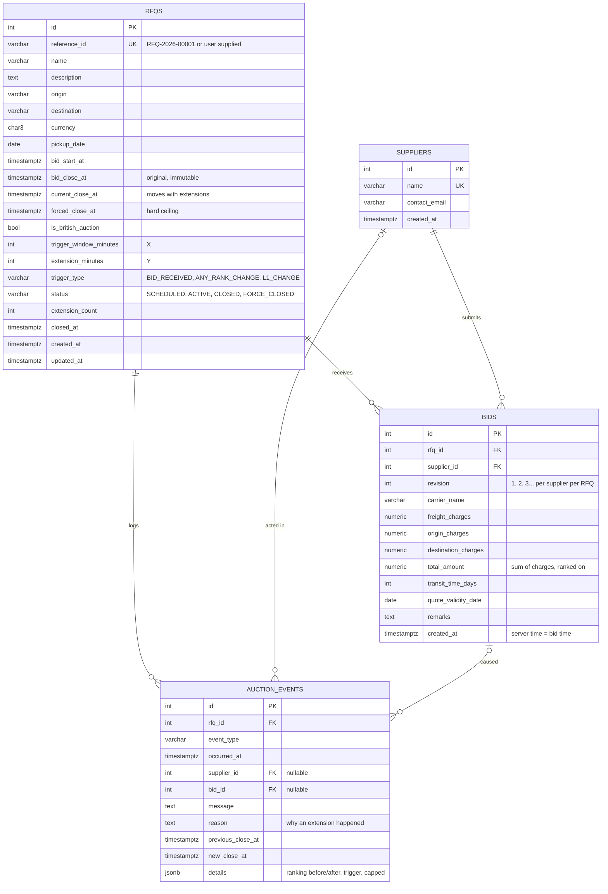

# Database Schema

PostgreSQL. Managed with Alembic (`backend/alembic/versions/0001_initial_schema.py`).
The exact DDL generated from the migration is in [`schema.sql`](schema.sql).



## Tables

### `rfqs`
One row per RFQ / auction.

* `bid_close_at` is what the buyer configured and never changes. `current_close_at` starts equal to it and is moved
  forward by extensions. Keeping both is what lets the UI show "originally 6:00 PM, now 6:10 PM" and lets metrics
  separate extended from non-extended auctions.
* `status` is persisted for filtering and indexing, but the API always recomputes it from the clock, so it is never stale.
* For a non-British RFQ, `forced_close_at = bid_close_at` and X/Y/trigger are `NULL`.

| Constraint | Rule |
|---|---|
| `ck_rfq_close_after_start` | `bid_close_at > bid_start_at` |
| `ck_rfq_forced_not_before_close` | `forced_close_at >= bid_close_at` |
| `ck_rfq_british_config_complete` | British auction ⇒ `forced_close_at > bid_close_at` **and** X > 0, Y > 0, trigger set (assignment §7) |
| `ck_rfq_current_close_within_bounds` | `bid_close_at ≤ current_close_at ≤ forced_close_at`: **an extension can never exceed the forced close** (assignment §7) |
| `trigger_type`, `auction_status` | enum value checks |
| `UNIQUE(reference_id)` | |

Index `ix_rfqs_status_close (status, current_close_at)` serves the background closer's
"active auctions whose close time has passed" scan and the status filter on the listing.

### `suppliers`
The carriers who bid. `UNIQUE(name)`.

### `bids`
**Append-only.** A supplier lowering their price inserts a new row (`revision + 1`). The previous rows stay as the audit
trail. A supplier's current quote is their lowest (= latest) row. The ranking orders suppliers by
`(total_amount, created_at)`, so on a tie whoever reached that price first ranks higher.

| Constraint / index | Purpose |
|---|---|
| `ck_bid_charges_non_negative`, `ck_bid_total_positive`, `ck_bid_transit_positive` | data sanity |
| `ix_bids_rfq_total (rfq_id, total_amount)` | lowest bid per RFQ (listing page) |
| `ix_bids_rfq_supplier_created (rfq_id, supplier_id, created_at)` | a supplier's history / current quote |
| FK `rfq_id → rfqs ON DELETE CASCADE` | |

`total_amount` is stored (not computed on read) so ranking and "lowest bid" queries are plain indexed lookups.

### `auction_events`
**Append-only activity log** behind the details page: RFQ created, bidding opened, each bid (with rank movement),
each extension **with its reason and old → new close time**, blocked extensions, and closure.
`details` (JSONB) keeps the machine-readable context (ranking before/after, trigger type, whether the extension was
capped) for debugging and analytics. Index `ix_events_rfq_id (rfq_id, id)`.

## Event types

| `event_type` | Written when |
|---|---|
| `RFQ_CREATED` | RFQ is created (includes the X/Y/trigger configuration) |
| `AUCTION_STARTED` | bid start time passes |
| `BID_SUBMITTED` | every accepted bid ("Gati bid 32,500 INR (revision 2), moved L3 → L1") |
| `AUCTION_EXTENDED` | a trigger fired and the close time moved; `reason`, `previous_close_at`, `new_close_at` set |
| `EXTENSION_CAPPED` | a trigger fired but the auction was already at its forced close |
| `AUCTION_CLOSED` | close time reached (below forced close) |
| `AUCTION_FORCE_CLOSED` | close time reached and it equals the forced close |

## Example query: the ranking for one RFQ

```sql
WITH best AS (
  SELECT DISTINCT ON (supplier_id) supplier_id, id, total_amount, created_at
  FROM bids
  WHERE rfq_id = :rfq_id
  ORDER BY supplier_id, total_amount, created_at
)
SELECT 'L' || ROW_NUMBER() OVER (ORDER BY total_amount, created_at, supplier_id) AS rank,
       s.name, b.*
FROM best b JOIN suppliers s ON s.id = b.supplier_id
ORDER BY total_amount, created_at, supplier_id;
```
